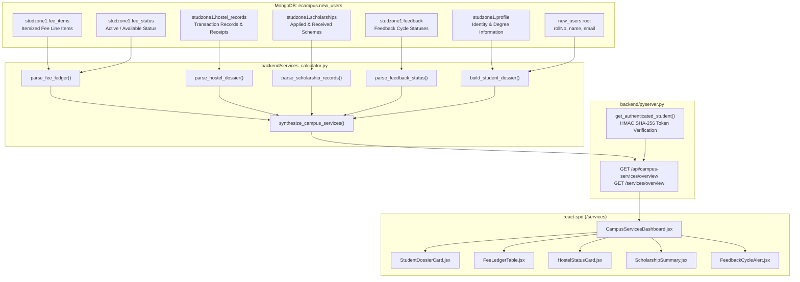

# Campus Services & Student Dossier System Specification (Phase 8)

## 1. Overview
The **Campus Services & Student Dossier Hub** (`/services`) elevates institutional administrative records from raw, unparsed scraper outputs into an authenticated, verified student services module for Student Sync.

This module completes the comprehensive student lifecycle:
- **Academic Core Modules:** Attendance (`/attendance`), Grades & Analytics (`/grades`), Schedule & Exams (`/schedule`), Personalized Study Planner (`/planner`).
- **Administrative & Campus Life Hub:** Campus Services & Student Dossier (`/services`) covering Institutional Fee Ledger, Hostel & Accommodation, Scholarships (Applied vs. Received/Disbursed), and Course Feedback Cycles.

> [!IMPORTANT]
> **This module is 100% READ-ONLY. Online payment gateways, fee collection, room-change submission, automated feedback bots, and scholarship approval predictions are STRICTLY EXCLUDED.**

---

## 2. Architecture & Data Flow



---

## 3. Pure Calculator Functions (`backend/services_calculator.py`)

1. **`clean_currency_value(val)`**:
   - Strips non-digit/decimal characters (`₹`, `$`, `INR`, commas, whitespace).
   - Converts valid numeric strings to floats.
   - Gracefully handles `None`, empty strings, and malformed text by returning `0.0`.

2. **`categorize_fee_item(fee_type)`**:
   - Maps fee items to standard institutional categories:
     - `Tuition` $\rightarrow$ Academic
     - `Development`, `Special & Other` $\rightarrow$ Institutional
     - `Examination`, `Mark Sheet` $\rightarrow$ Examinations
     - `Anna University Academics` $\rightarrow$ University
     - `Graduate Association` $\rightarrow$ Association
     - `Computer Application Association` $\rightarrow$ Department
     - `Sports` $\rightarrow$ Sports
     - Fallback $\rightarrow$ General

3. **`parse_fee_ledger(raw_fees, raw_items)`**:
   - Normalizes line items and amounts.
   - Deduplicates repeated line items if encountered from raw table extraction.
   - Extracts reported total from summary rows (`TOTAL`) and computes sum from verified line items.
   - Preserves official fee status (`Active / Available`).

4. **`parse_hostel_dossier(raw_hostel, profile)`**:
   - Determines residency type (`Hosteller` vs. `Day Scholar`).
   - Extracts allocated room number (`K519`) from verified profile records.
   - Parses payment transaction history (receipt ID, date, amount, transaction status).
   - Gracefully returns Day Scholar empty states when unassigned.

5. **`parse_scholarship_records(raw_scholarships)`**:
   - **Critical Data Rule:** Keeps **Applied** records and **Received / Disbursed** records strictly separate.
   - Never infers eligibility or predicts approval.
   - Extracts scheme name, academic year, application status, tutor verification, and disbursed amounts.

6. **`parse_feedback_status(raw_feedback)`**:
   - Evaluates active/open evaluation windows (`status.lower() != 'not scheduled'`).
   - Tracks cycle types (`End Semester`, `Intermediate`).
   - Purely observational; does not submit responses.

7. **`build_student_dossier(user_doc)`**:
   - Synthesizes verified identity attributes: Roll Number, Name, Degree, Institution, Semester, Admission Quota, Resident Status, Room Number, Email, Mobile, and Date of Birth.
   - Strictly omits internal database fields (`_id`, `password`, `changeHash`).

---

## 4. API Specification

### Endpoint: `GET /api/campus-services/overview` (Alias: `GET /services/overview`)

- **HTTP Method:** `GET`
- **Authentication:** HMAC SHA-256 Bearer Token / Query parameter verified via `get_authenticated_student(request)`
- **Parameters:**
  - `auth_token` (Required): Authenticated session token
  - `rollNo` (Optional): If provided, must match the authenticated token roll number
- **Database Operations:** **STRICTLY READ-ONLY** (`find_one` only)
  - Zero `insert_one`
  - Zero `update_one`
  - Zero `replace_one`
  - Zero `delete_one`

#### HTTP Status Codes:
- `200 OK`: Valid authenticated student; returns normalized JSON payload.
- `401 Unauthorized`: Missing or invalid authentication token.
- `403 Forbidden`: Cross-user access attempt (token roll number does not match requested roll number).
- `404 Not Found`: Authenticated student document does not exist in `new_users`.

#### Response Schema:
```json
{
  "student_dossier": {
    "rollNo": "25MX232",
    "name": "VISHALY S",
    "email": "25mx232@psgtech.ac.in",
    "institution": "PSG College of Technology",
    "degree": "MASTER OF COMPUTER APPLICATIONS",
    "semester": 3,
    "admission_type": "MERIT",
    "resident_status": "HOSTELLER",
    "room_number": "K519",
    "mobile": "9976477887",
    "dob": "12/04/2005"
  },
  "fees": {
    "status": "Active / Available",
    "total_amount": 37300.0,
    "reported_total": 37300.0,
    "currency": "INR",
    "item_count": 9,
    "items": [
      {
        "name": "TUITION FEES",
        "amount": 18000.0,
        "raw_amount": "₹ 18000",
        "category": "Academic",
        "details": []
      }
    ],
    "breakdown_by_category": {
      "Academic": 18000.0,
      "Institutional": 10375.0,
      "Examinations": 5300.0,
      "Association": 1000.0,
      "Department": 500.0,
      "Sports": 125.0,
      "University": 2000.0
    }
  },
  "hostel": {
    "status": "Registered / Hostel Data Available",
    "is_hosteller": true,
    "resident_type": "Hosteller",
    "room_number": "K519",
    "payment_count": 1,
    "total_paid": 138000.0,
    "payments": [
      {
        "receipt_id": "PSGHOS122904621140",
        "s_no": "1",
        "date": "12/06/2026",
        "amount": 138000.0,
        "status": "Success"
      }
    ]
  },
  "scholarships": {
    "applied_count": 1,
    "received_count": 1,
    "applied": [
      {
        "year": "2025-2026",
        "scholarship_id": "180",
        "scheme_name": "Tamil Nadu Unorganised Workers Welfare Board",
        "tutor_approval": "Yes",
        "application_status": "Not Approved",
        "amount": 6000.0
      }
    ],
    "received": [
      {
        "year": "2025-2026",
        "scheme_name": "Tamil Nadu Unorganised Workers Welfare Board",
        "disbursement_status": "Yes",
        "amount": 6000.0
      }
    ]
  },
  "feedback": {
    "active_count": 0,
    "total_cycles": 2,
    "cycles": [
      {
        "type": "End Semester",
        "status": "Not Scheduled",
        "description": "Feedback is currently not scheduled for this session.",
        "is_active": false
      },
      {
        "type": "Intermediate",
        "status": "Not Scheduled",
        "description": "Feedback is currently not scheduled for this session.",
        "is_active": false
      }
    ]
  },
  "disclaimer": "Official campus records sourced directly from StudZone 1 portal. Zero modifications permitted."
}
```

---

## 5. Security & Privacy Guarantees

1. **HMAC Token Verification:**
   Every request must carry an authentic token issued by `generate_auth_token(roll_no)`.
2. **Strict Student Isolation:**
   Cross-user requests (`token_roll != query_roll`) are rejected with HTTP 403 Forbidden.
3. **No Sensitive PII Exposure:**
   Password hashes, internal database IDs (`_id`), notification hashes, and change tracking tokens are strictly excluded from output payloads.
4. **Zero-Write Invariance:**
   The API has zero database mutation privileges. Authenticated student documents are byte-for-byte identical before and after invocation.

---

## 6. Frontend Components (`react-spd`)

- **`CampusServicesDashboard.jsx`**: Master view route (`/services`) with session guard, error boundary, loading skeletons, and modular sections.
- **`StudentDossierCard.jsx`**: Identity card displaying verified roll number, degree, quota, accommodation, and verified contact details.
- **`FeeLedgerTable.jsx`**: Interactive, category-filtered table displaying the 9 fee components, category badges, and read-only notice.
- **`HostelStatusCard.jsx`**: Accommodation card displaying residency type, room number (`K519`), and transaction records.
- **`ScholarshipSummary.jsx`**: Tabbed interface cleanly separating Applied applications from Received disbursements.
- **`FeedbackCycleAlert.jsx`**: Observational card reflecting teacher evaluation windows without automated submission.

---

## 7. Prohibited Operations & Out-of-Scope Features

The following are strictly forbidden and not implemented in Phase 8:
- Online fee payment gateways or bank redirects.
- Automated feedback submission bots.
- Hostel room-change requests or warden approvals.
- Algorithmic prediction of scholarship approval chances.
- SEE mark or grade predictions.
- Offline PWA service worker mutations.
