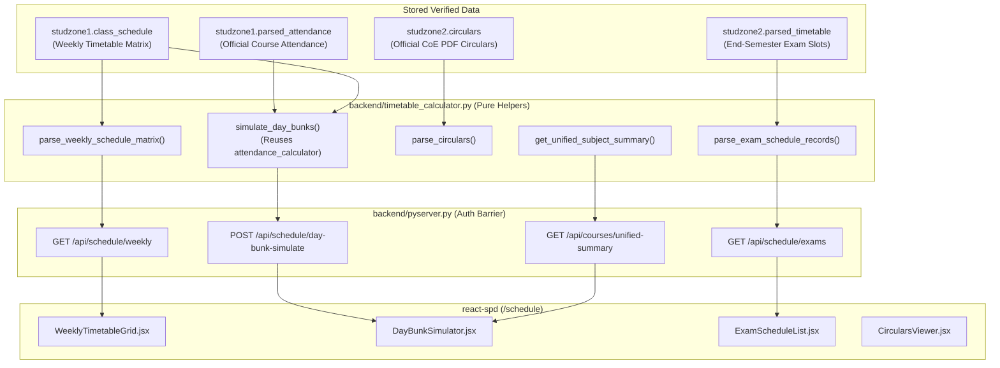

# Schedule & Examination Intelligence System Specification (Phase 6)

## 1. Overview
The **Interactive Timetable Intelligence, Day-Bunk Planner, and End-Semester Examination Hub** (`/schedule`) provides verified schedule transparency, real-time in-memory attendance impact modeling across multi-period daily absences, and official examination schedule tracking for Student Sync.

This implementation strictly complies with institutional academic and examination practices at **PSG College of Technology** and adheres to zero-write database safety standards.

> [!IMPORTANT]
> **Deterministic SEE target-grade estimation is strictly forbidden because theory courses use relative grading without individual determinism. Academic Calendar, CA Deadline Tracker, Exam Seating Locator, and Notification Triggers are postponed to maintain absolute scraper and notification baseline integrity.**

---

## 2. Architecture & Data Sources

Phase 6 operates exclusively on pre-synchronized, verified fields from the student's unified database record:



### Verified MongoDB Data Fields:
1. **`studzone1.class_schedule`**:
   - 7-row table array extracted from StudZone 1:
     - Row 0: Period numbers (`['Period', '1', '2', '3', '4', '5', '6']`).
     - Row 1: Period timings (`['Time', '8.30 - 9.20', '9.20 - 10.10', ...]`).
     - Rows 2–6: Days Monday through Friday (`['Monday', '...', ...]`).
   - Cells contain multi-line text with section, course code, and course title:
     `MCA_3\r\n 23MX31\nCLOUD COMPUTING`
   - Free/unallocated periods are recorded as `'-'` or empty values.
   - Non-academic slots (e.g. `TWM` - Tutor Ward Meeting) are cleanly categorized.

2. **`studzone2.parsed_timetable`**:
   - Array of examination slots extracted from StudZone 2 (`FrmEpsStudTimetable.aspx`):
     - `course_code`: Course code (e.g., `"23MX31"`).
     - `course_title`: Course title (e.g., `"CLOUD COMPUTING"`).
     - `exam_date`: Official date or portal status (e.g., `"Schedule Pending"` or `"TBA"`).
     - `session`: Session code (e.g., `"FN"` for Forenoon, `"AN"` for Afternoon).
     - `timing`: Portal timing string (e.g., `"09:30 AM - 12:30 PM"` or empty).

3. **`studzone2.circulars`**:
   - Array of official CoE circulars from StudZone 2:
     - `title`: Circular document title (e.g., `"Autonomous Examinations - Instructions to Candidates"`).
     - `url`: Direct portal PDF link (verified external URL).

4. **`studzone1.parsed_attendance`**:
   - Subject-level attendance records (`code`, `name`, `attended`, `total_classes`, `percentage`, `percentage_num`, `status`).

---

## 3. Pure Helper Module (`backend/timetable_calculator.py`)

The module is designed with zero side-effects and zero MongoDB writes.

### A. Cell Parsing Logic
The helper `parse_cell_content(cell_str)` extracts structured information from the raw multi-line strings:
- Splits by lines and cleans whitespace.
- Detects free periods (`'-'`, `''`, `'FREE'`, `'NIL'`).
- Extracts Course Code using institutional patterns (`^[0-9]{2}[A-Z]{2}[0-9A-Z]{2,4}$` or standard prefixes like `TWM`).
- Extracts Course Title by removing section prefix (e.g., `MCA_3`) and course code.
- Preserves section information when available.

### B. Matrix Normalization
`parse_weekly_schedule_matrix(schedule_matrix)`:
- Validates row structure (periods row, timing row, 5 day rows).
- Normalizes day names (`Monday`, `Tuesday`, `Wednesday`, `Thursday`, `Friday`).
- Returns structured JSON with period definitions and a day-by-day mapping of period slots.

### C. Safe Status Handling for Exam Schedules
`parse_exam_schedule_records(exam_records)`:
- Normalizes session strings (`FN` / `AN`).
- **Critical Safety Rule**: If `exam_date` is empty, `"Schedule Pending"`, `"TBA"`, or unavailable, the parser outputs `status: "PENDING"` and preserves the raw portal text. It **never invents, guesses, or estimates** an exam date.

### D. Safe CoE Circulars Parsing
`parse_circulars(circulars_list)`:
- Sanitizes circular titles and URLs.
- If URLs or circular data are unavailable, provides empty collections without inventing mock links.

---

## 4. In-Memory Day-Bunk Simulator

### A. Mathematical Formulation
When a student selects a specific day $D$ and a subset of periods $P \subseteq \{1, 2, 3, 4, 5, 6\}$:

1. **Course Occurrence Mapping**:
   For each period $p \in P$, determine the scheduled course $C(D, p)$. Free periods and non-course slots are ignored.
   $$\text{MissedPeriods}(C) = \sum_{p \in P} \mathbb{I}(C(D, p) = C)$$

2. **Attendance Projection**:
   For each affected subject $C$ with current attended classes $A_C$ and conducted classes $T_C$:
   $$\text{Attended}_{\text{proj}}(C) = A_C$$
   $$\text{Conducted}_{\text{proj}}(C) = T_C + \text{MissedPeriods}(C)$$
   $$\text{Percentage}_{\text{proj}}(C) = \frac{A_C}{T_C + \text{MissedPeriods}(C)} \times 100$$

3. **Safe Bunk Recalculation**:
   Using the verified formula from `attendance_calculator.calculate_safe_bunks(attended, conducted, target)`:
   $$\text{SafeBunks}(A, T, \tau) = \max\left(0, \left\lfloor \frac{A - \frac{\tau}{100} \cdot T}{\frac{\tau}{100}} \right\rfloor\right)$$
   $$\Delta \text{SafeBunks}(C) = \text{SafeBunks}_{\text{proj}}(C) - \text{SafeBunks}_{\text{current}}(C)$$

4. **Institutional Boundary Alerts**:
   - **Condonation Risk (Below 75%)**: $\text{Percentage}_{\text{proj}}(C) < 75.0\%$
     $$\text{ClassesNeededToReach75} = \max\left(0, \lceil 3 \cdot T_{\text{proj}} - 4 \cdot A \rceil\right)$$
   - **Redo Risk (Below 65%)**: $\text{Percentage}_{\text{proj}}(C) < 65.0\%$
     Student enters redo territory requiring course repetition according to PSG Tech regulations.

### B. Overall Metric Impact
$$\text{Attended}_{\text{overall, proj}} = \sum A_i$$
$$\text{Conducted}_{\text{overall, proj}} = \sum T_i + \sum_{C} \text{MissedPeriods}(C)$$
$$\text{Overall}_{\text{proj}} = \frac{\sum A_i}{\text{Conducted}_{\text{overall, proj}}} \times 100$$

### C. Zero-Write Guarantee
The simulation executes 100% in-memory:
- No database collections are written to.
- No user records are updated.
- No attendance counters in MongoDB are mutated.
- Official attendance remains invariant at 258/310 (83.23% for test user `25MX232`).

---

## 5. Security & Isolation Barrier

All schedule and exam endpoints require verified session authentication:

```python
authenticated_roll = get_authenticated_student(request)
```

### Authorization Matrix:
| Scenario | Request | Header / Token | Response Status | Access |
| :--- | :--- | :--- | :---: | :---: |
| Missing Auth | Any Schedule API | No `Authorization` | **401 Unauthorized** | Denied |
| Invalid Auth | Any Schedule API | Malformed / Expired | **401 Unauthorized** | Denied |
| Cross-User Spoof | `?rollNo=25MX227` | Token for `25MX232` | **403 Forbidden** | Denied |
| Legitimate Own | Any Schedule API | Token for `25MX232` | **200 OK** | Verified Data |

The authenticated roll number is derived exclusively from the verified token context, never from client-supplied URL query parameters or bodies.

---

## 6. Backend API Contracts

### A. GET `/api/schedule/weekly`
- **Method:** `GET`
- **Auth:** Bearer Token
- **Query:** `rollNo` (optional, must match authenticated user)
- **Response Structure:**
  ```json
  {
    "roll_no": "25MX232",
    "periods": [1, 2, 3, 4, 5, 6],
    "timings": ["8.30 - 9.20", "9.20 - 10.10", "10.30 - 11.20", "11.20 - 12.10", "01.40 - 02.30", "02.30 - 03.20"],
    "days": {
      "Monday": [
        {
          "period": 1,
          "timing": "8.30 - 9.20",
          "is_free": false,
          "course_code": "23MX31",
          "course_title": "CLOUD COMPUTING",
          "attendance": { "percentage": 75.68, "safe_bunks": 0 }
        }
      ]
    },
    "zero_write": true
  }
  ```

### B. GET `/api/schedule/exams`
- **Method:** `GET`
- **Auth:** Bearer Token
- **Response Structure:**
  ```json
  {
    "roll_no": "25MX232",
    "exam_slots": [
      {
        "course_code": "23MX31",
        "course_title": "CLOUD COMPUTING",
        "exam_date": "Schedule Pending",
        "session": "FN",
        "timing": "",
        "status": "PENDING"
      }
    ],
    "circulars": [
      {
        "title": "Autonomous Examinations - Candidate Instructions",
        "url": "https://ecampus.psgtech.ac.in/StudZone2/...",
        "is_official": true
      }
    ],
    "zero_write": true
  }
  ```

### C. POST `/api/schedule/day-bunk-simulate`
- **Method:** `POST`
- **Auth:** Bearer Token
- **Payload:**
  ```json
  {
    "day": "Friday",
    "periods": [1, 2, 3],
    "target": 75.0
  }
  ```
- **Response Structure:**
  ```json
  {
    "day": "Friday",
    "target": 75.0,
    "periods_missed": [1, 2, 3],
    "total_periods_missed": 3,
    "overall": {
      "current_percentage": 83.23,
      "projected_percentage": 82.43,
      "change": -0.8
    },
    "affected_subjects": [
      {
        "course_code": "23MXAF",
        "course_title": "DATA MINING AND ANALYTICS",
        "classes_missed": 1,
        "current_percentage": 97.44,
        "projected_percentage": 95.0,
        "current_safe_bunks": 11,
        "projected_safe_bunks": 10,
        "safe_bunk_change": -1,
        "below_75": false,
        "below_65": false
      }
    ],
    "warnings": {
      "any_below_75": false,
      "any_below_65": false,
      "critical_courses": []
    },
    "simulation": true,
    "zero_write": true
  }
  ```

### D. GET `/api/courses/unified-summary`
- **Method:** `GET`
- **Auth:** Bearer Token
- **Response Structure:** Subject-level unified summary merging attendance records and scheduled timetable frequencies.

---

## 7. Frontend Component Hierarchy

The frontend is located at `react-spd/src/ScheduleDashboard.jsx` and mounted on `/schedule`:

```
react-spd/src/ScheduleDashboard.jsx
├── MetricSummaryStrip (Quick attendance & exam status cards)
├── TabNavigation:
│   ├── [weekly] -> WeeklyTimetableGrid.jsx
│   │   ├── DaySelector (Monday - Friday tabs + Full Week View)
│   │   ├── CurrentDayHighlight (Auto-detects active day of the week)
│   │   ├── PeriodSlots (Timing, Subject Code, Subject Name, Free Indicator)
│   │   └── SubjectAttendanceBadge (Linked to existing attendance percentage)
│   ├── [bunk]   -> DayBunkSimulator.jsx
│   │   ├── DayRadioSelector
│   │   ├── MultiPeriodCheckboxSelector
│   │   ├── TargetPercentageSelector (75%, 80%, 85%)
│   │   ├── ImpactSummaryCards (Total missed, Projected overall attendance)
│   │   ├── SubjectImpactTable (Classes missed, % drop, safe bunks change)
│   │   └── CondonationAlerts (Warning banners for drops < 75% and < 65%)
│   ├── [exams]  -> ExamScheduleList.jsx
│   │   ├── ExamSlotCards (Course code, Title, Session, Time)
│   │   └── PortalStatusBadge ("SCHEDULE PENDING" / "TBA" portal preservation)
│   └── [docs]   -> CircularsViewer.jsx
│       └── CoECircularCards (Official document links with external indicators)
```

---

## 8. Explicit UI Safety Rules

1. **Zero Hardcoded Data**:
   - Exam dates, timings, rooms, CA dates, and circular links are strictly derived from verified MongoDB data.
   - If an exam date is `"Schedule Pending"`, it is rendered with a dedicated amber badge: `"SCHEDULE PENDING"`. No estimated dates are ever created.
   - If circulars are empty, the UI displays `"No official circulars published on portal"`.
2. **Attendance Quick Metrics**:
   - Displayed alongside timetable subjects from existing `parsed_attendance`.
   - Never recalculates or modifies the official attendance engine.

---

## 9. Explicit Postponed & Forbidden Features

| Feature | Status | Rationale |
| :--- | :--- | :--- |
| **Deterministic SEE Target Estimator** | **FORBIDDEN** | PSG Tech theory courses use relative grading; no individual cutoff exists without cohort parameters. |
| **Fixed Theory Grade Cutoffs** | **FORBIDDEN** | Absolute cutoffs (e.g., 90=O, 85=A+) violate relative grading rules. |
| **Academic Calendar Scraper** | **POSTPONED** | Requires new external scraping routes; outside zero-scraper-touch scope. |
| **CA Deadline Tracker** | **POSTPONED** | No deadline data field exists in current StudZone tables; requires future phase. |
| **Exam Seating Locator** | **POSTPONED** | Seating arrangement is only published during active examination windows. |
| **Real-Time Notification Triggers** | **POSTPONED** | Notification engine is frozen to prevent email or baseline disruption. |
| **New Scrapers / Schedulers** | **POSTPONED** | Absolute protection rule prohibits adding or altering scrapers. |

---

## 10. Production Safety & Database Invariants

All operations in Phase 6 maintain the following invariants:
- **Total MongoDB Users**: Exactly 5
- **Total Notification Records**: Exactly 67
- **Total Registered Subjects**: Exactly 15
- **25MX232 Official Attendance**: Exactly 258/310 (83.23%)
- **25MX232 Official CGPA**: Exactly 7.96
- **Database Collections & Indexes**: 0 changes
- **Database Mutation Operations**: 0 writes executed during any schedule query or simulation.
